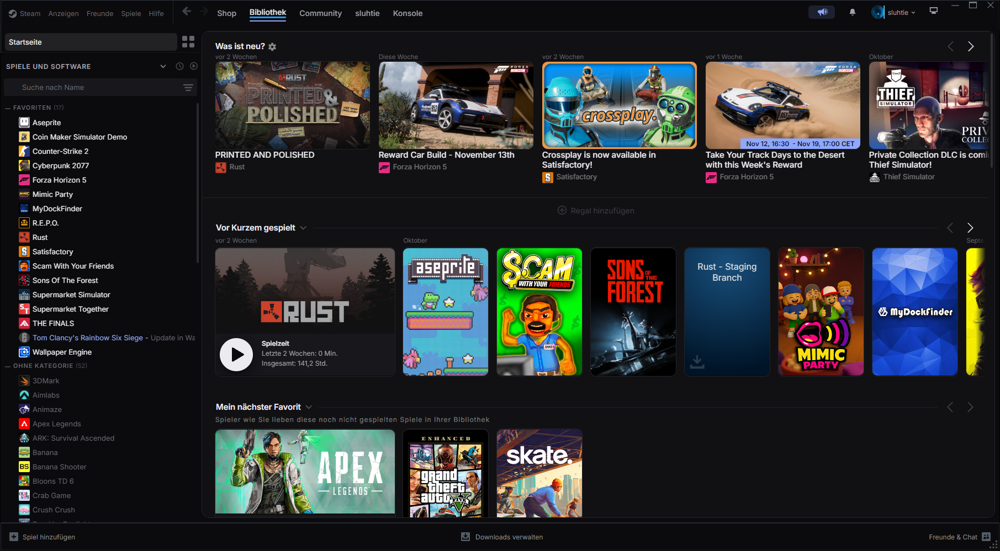
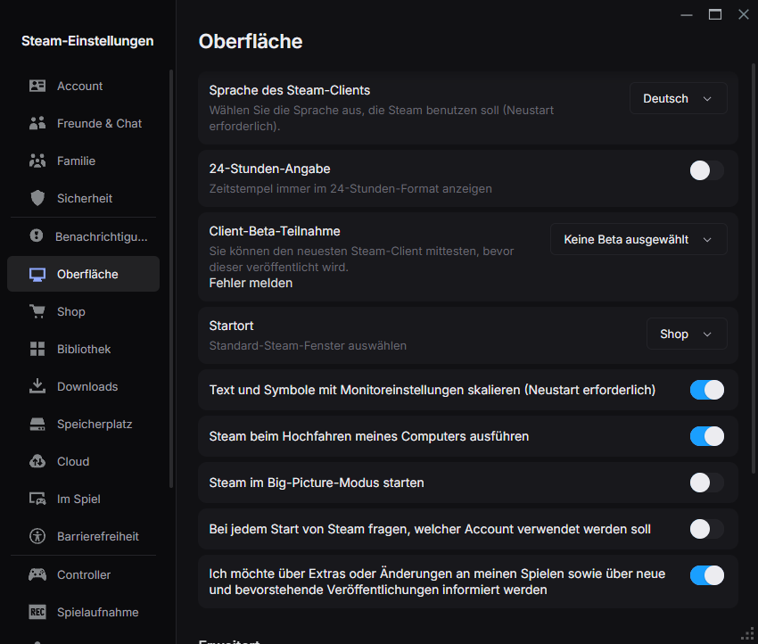
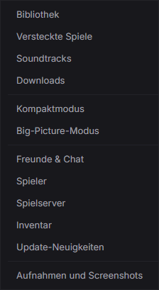
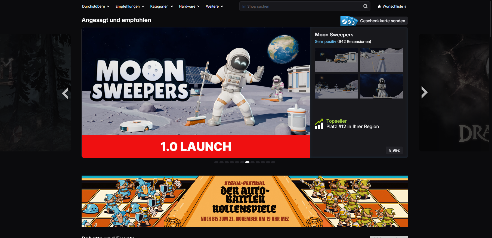

# Graphite

A clean, minimal and modern theme for the Steam desktop client, built for [Millennium](https://steambrew.app).

Neutral graphite surfaces, one accent color, quiet typography, a single-row header and an inset content panel. No gradients, no glow, no visual noise.



| Settings | Menus |
| --- | --- |
|  |  |



## What it themes

- **Window frame**: menu bar and Store / Library / Community tabs merged into one row, flat window controls, slim bottom bar
- **Library**: game list, home page shelves and capsules, game details page (hero fade, play bar, sections, activity feed)
- **Menus**: root menus, nav dropdowns and context menus
- **Dialogs**: settings window, toggles, inputs, buttons, modals
- **Friends**: friends list and chat windows
- **Store & Community pages** (optional, on by default): flat backgrounds, neutral cards and buttons on the store home, game pages, search, community home, hubs, discussions and profiles. Custom profile backgrounds stay visible, and discount badges keep Steam's green.

The store and community are Valve's web pages. They use stable class names, but some newer React parts use hashed names from Valve's servers, which the build can't resolve locally. Those parts are styled through structural selectors or left alone.

## Install

1. Install [Millennium](https://steambrew.app).
2. Clone this repo into Steam's theme folder:

   ```powershell
   cd "C:\Program Files (x86)\Steam\millennium\themes"
   git clone https://github.com/sluhtie/steamtheme
   ```

   (Or download the ZIP and extract it there.)
3. Restart Steam, open **Steam → Millennium → Themes** and select **Graphite**.

## Customize

In **Millennium → Themes → Graphite**:

- **Colors**: accent, play button, background, surfaces, borders and three text levels are all editable.
- **Font**: Inter (default, loaded from Google Fonts), System (Segoe UI) or Steam's Motiva Sans.
- **Corners**: Rounded or Sharp.
- **Header**: Single row (default) or Classic two-row layout.
- **Store & community pages**: restyle the in-client web pages (on by default).
- **Hide URL bar** and **Hide What's New**.

## How it works

Steam's UI uses hashed CSS-module class names (for example `_3pofGqV0buiKAfMPEs3_82`) that change with client updates. Graphite's source CSS in `src/` uses readable tokens instead, and a small build step resolves them against your Steam install:

```css
/* src/partials/frame.css */
.$(SuperNavMenu).$(Selected@SuperNav) .$(MenuButton@SuperNav) { color: var(--gr-text); }
```

- `$(Key)` is the class `Key` from Steam's CSS modules. It must be unique.
- `$(Key@Anchor)` is `Key` from the module that also defines `Anchor`, which disambiguates common names like `Container`.

`tools/build.mjs` reads Steam's `steamui/*.js` bundles, extracts every module's `name -> hash` map and writes the resolved CSS to `build/`. That output is committed, so the theme works without a build step.

### After a Steam update

If parts of the theme stop applying after a Steam client update, the hashes have probably changed. Rebuild the theme (requires [Node.js](https://nodejs.org) 18+):

```powershell
cd "C:\Program Files (x86)\Steam\millennium\themes\steamtheme"
node tools/build.mjs
```

Then restart Steam. The build lists any token it can no longer find.

### Development

| Command | Purpose |
| --- | --- |
| `npm run build` | Resolve tokens and write `build/` |
| `npm run live` | Inject the built theme into a running Steam started with `-dev` (DevTools on port 8080), without restarting Steam |
| `node tools/lookup.mjs <Key or hash>` | Show which Steam module defines a class, plus unique anchors |

Layout:

```text
skin.json        Millennium manifest: window patches and options
colors.css       Editable color variables (Millennium RootColors)
src/             Source CSS with $(Token) class references
  main.css       Main window (library, frame)
  menus.css      Popup menus
  dialogs.css    Settings and other dialog windows
  friends.css    Friends list and chat
  partials/      Shared pieces pulled in with @import
  options/       Stylesheets toggled by theme options (webkit.css = store/community)
build/           Generated output loaded by Millennium (do not edit)
tools/           Build, live preview and lookup scripts
```

## License

MIT
