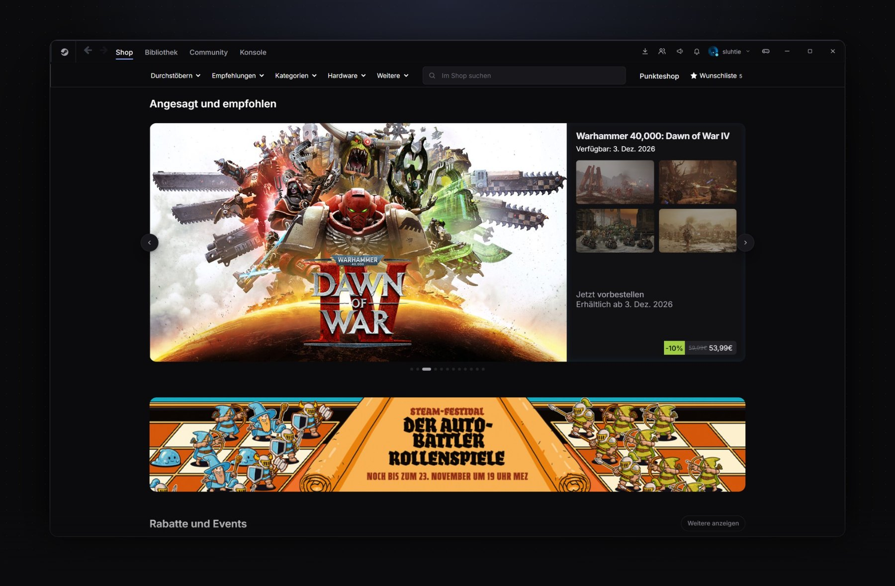
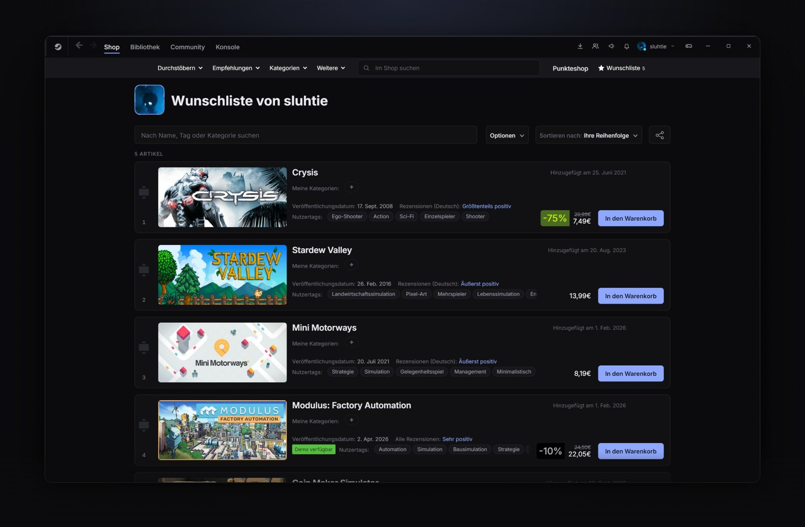
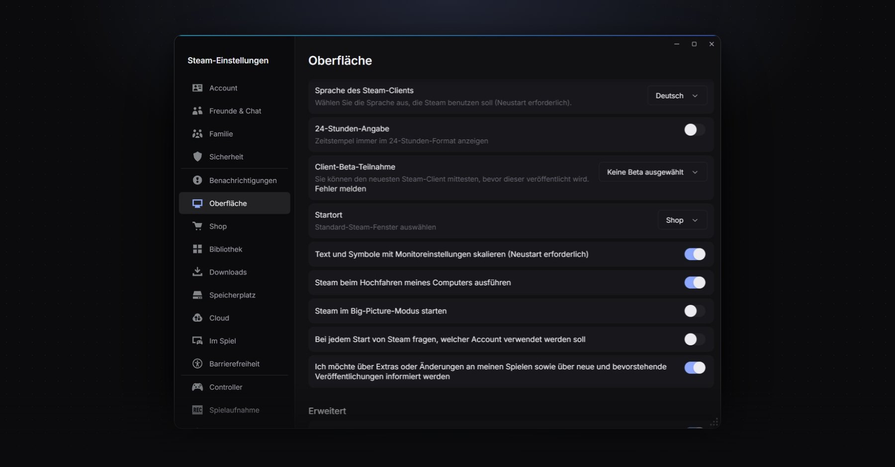
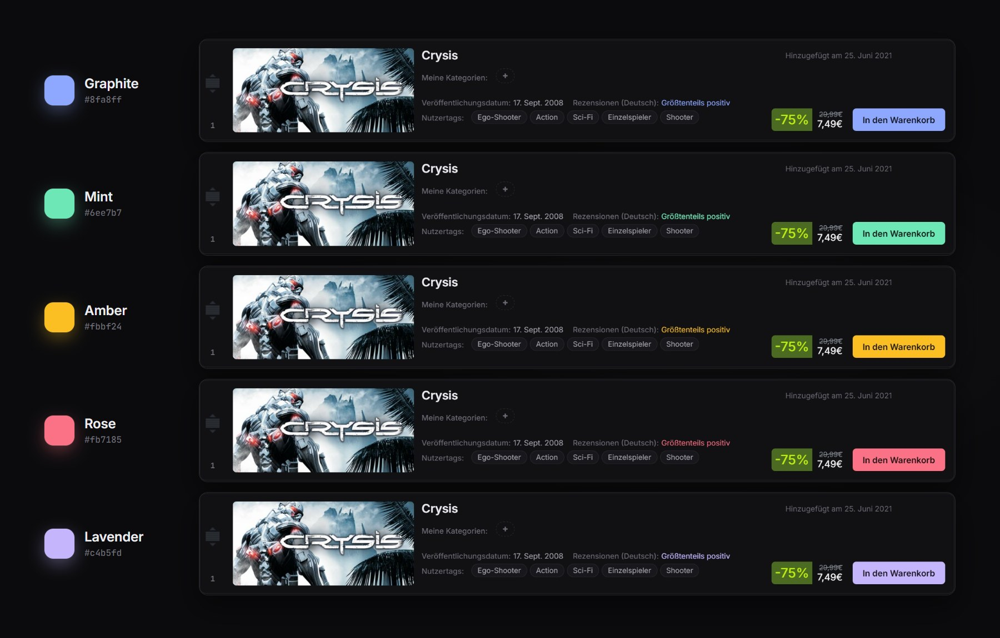

# Graphite

**A clean, minimal and modern theme for the Steam desktop client, built for [Millennium](https://steambrew.app).**

Neutral graphite surfaces, one accent color you choose, quiet typography and a single-row header. Graphite restyles the whole client, from the library and menus to the store, community and friends chat, without gradients, glow or visual noise.

[](https://steambrew.app/theme/AhWCRyHBVXoohiaVWWBW)
[](https://github.com/sluhtie/graphite-steam/commits/main)
[](https://github.com/sluhtie/graphite-steam/commits/main)
[](https://github.com/sluhtie/graphite-steam/stargazers)
[](LICENSE)

---

## Highlights


## Screenshots

**Library**


| **Game details** | **Store** |
| --- | --- |
|  |  |
| **Store game page** | **Wishlist** |
|  |  |
| **Community Market** | **Settings** |
|  |  |

## What it themes

| | Area | What changes |
| --- | --- | --- |
| 🧭 | **Navigation** | One row: Steam logo, back / forward, Store / Library / Community, downloads, friends, notifications and account. View / Friends / Games / Help fold away behind the logo. The store keeps its own nav (plus a Points Shop link), community pages get a slim sub-navigation incl. your profile, inventory and badges. |
| 🪟 | **Window frame** | Own icon set for the title bar and window controls, round avatar with a status dot. The bottom bar is gone: Downloads (with progress) and Friends & Chat live in the title bar. |
| 🎮 | **Library** | Game list, home shelves and capsules, hover cards, game details (hero, play bar, sections, activity), news and patch notes overlay, downloads, console. |
| 🛒 | **Store** | Calm store front with one rounded hero, redesigned game pages (one card per purchase option, plain feature and link lists), wishlist, search, discovery queue, news hub, calendar and charts. |
| 👥 | **Community** | Home, hubs, discussions, workshop, activity, profiles, friends and groups, screenshots / artwork / guides, badges, inventory and the Community Market incl. the new item pages. |
| 💬 | **Friends & chat** | Friends list with status dots and tidy group chats, a roomy chat window, emoji picker. |
| 🧩 | **Menus & dialogs** | Root menus, nav dropdowns, context menus, the settings window, toggles, inputs, buttons and modals. |

Custom profile backgrounds stay visible, discount badges keep Steam's green, and item rarity and online / in-game colors are untouched.

## Make it yours



Everything is set in **Millennium → Themes → Graphite**:

| Option | Choices |
| --- | --- |
| **Colors** | Accent, play button, background, surfaces, borders and three text levels, all editable |
| **Font** | Inter (default), System (Segoe UI), Motiva Sans |
| **Corners** | Rounded (default), Sharp |
| **Header** | Single row (default), Classic two-row layout |
| **Navigation** | Clean (default), Classic (Steam's own menus and hover dropdowns) |
| **Store & community pages** | Restyle the in-client web pages (on by default) |
| **Extras** | Hide URL bar (on by default), Hide What's New |

## Install

1. Install [Millennium](https://steambrew.app).
2. Get Graphite from its page on [steambrew.app](https://steambrew.app/theme/AhWCRyHBVXoohiaVWWBW), or clone it into Steam's theme folder:

   ```powershell
   cd "C:\Program Files (x86)\Steam\millennium\themes"
   git clone https://github.com/sluhtie/graphite-steam
   ```

   You can also download the ZIP and extract it there.
3. Restart Steam, open **Steam → Millennium → Themes** and select **Graphite**.

## After a Steam update

Steam's UI uses hashed class names (like `_3pofGqV0buiKAfMPEs3_82`) that can change with client updates. If parts of the theme stop applying, rebuild it against your install (needs [Node.js](https://nodejs.org) 18+):

```powershell
cd "C:\Program Files (x86)\Steam\millennium\themes\graphite-steam"
node tools/build.mjs
```

Then restart Steam. The build lists any class it can no longer find.

## How it works

Graphite's source CSS in `src/` uses readable tokens instead of hashes, and a small build step resolves them against your Steam install:

```css
/* src/partials/frame.css */
.$(SuperNavMenu).$(Selected@SuperNav) .$(MenuButton@SuperNav) { color: var(--gr-text); }
```

- `$(Key)` is the class `Key` from Steam's CSS modules. It must be unique.
- `$(Key@Anchor)` is `Key` from the module that also defines `Anchor`, for common names like `Container`.

`tools/build.mjs` reads Steam's `steamui/*.js` bundles, extracts every module's `name -> hash` map and writes the resolved CSS and scripts to `build/`. That output is committed, so the theme works without a build step.

The store and community are Valve's web pages. Older parts use stable class names; newer React parts use Valve's web design system, whose color scales Graphite remaps on `:root`. Two small local scripts handle the rest. Neither makes network requests.

- **`src/scripts/web-recolor.js`** (Store & community option): swaps the hardcoded blue-greys of Valve's newest React pages for Graphite surfaces. It also tags the parts of the wishlist, game pages, news hub and event overlay with stable `gr-*` classes, so the theme can restyle them despite Valve's changing class names.
- **`src/scripts/nav.js`** (Clean navigation): stops the tab dropdowns from opening on hover, moves Downloads and Friends & Chat into the title bar and adds the community sub-navigation.

## Development

| Command | Purpose |
| --- | --- |
| `npm run build` | Resolve tokens and write `build/` |
| `npm run live` | Inject the built theme into a running Steam started with `-dev` (DevTools on port 8080), without restarting Steam |
| `node tools/lookup.mjs <Key or hash>` | Show which Steam module defines a class, plus unique anchors |
| `node tools/render-docs.mjs ...` | Render the README images from `docs/src` (see [docs/src/README.md](docs/src/README.md)) |

```text
skin.json        Millennium manifest: window patches and options
colors.css       Editable color variables (Millennium RootColors)
src/             Source CSS with $(Token) class references
  main.css       Main window (library, frame)
  menus.css      Popup menus
  dialogs.css    Settings and other dialog windows
  friends.css    Friends list and chat
  partials/      Shared pieces pulled in with @import
  options/       Stylesheets toggled by theme options (webkit.css = store/community)
  scripts/       nav.js (clean navigation), web-recolor.js (React web pages)
build/           Generated output loaded by Millennium (do not edit)
tools/           Build, live preview, lookup and docs render scripts
docs/            README images; docs/src holds their HTML sources
```

## License

[MIT](LICENSE)
