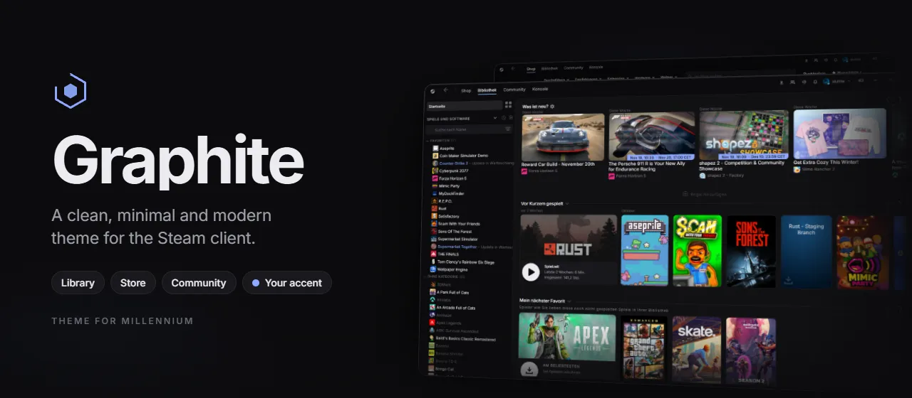

# Graphite

**A clean, minimal and modern theme for the Steam desktop client, built for [Millennium](https://steambrew.app).**

Neutral graphite surfaces, one accent color you choose and quiet typography. Graphite restyles the whole client, from the library and menus to the store, community and friends chat, without gradients, glow or visual noise.

**New in 2.1:** a start page of your own for Home (Cockpit, Spotlight or Bento), the Graphite settings page in every layout, layout options that show what works together, and fixes from your reports. Graphite 2.0 brought the rebuilt app layout with an icon rail, one search for your library and the store, a side navigation and a friends dock.

[](https://steambrew.app/theme/AhWCRyHBVXoohiaVWWBW)
[](https://github.com/sluhtie/graphite-steam/commits/main)
[](https://github.com/sluhtie/graphite-steam/commits/main)
[](https://github.com/sluhtie/graphite-steam/stargazers)
[](LICENSE)

---

## What's new in 2.1

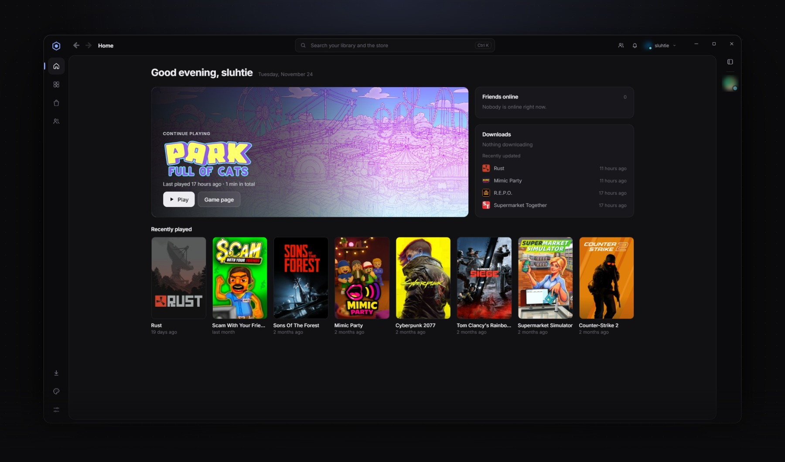

- **Start pages** for Home in Graphite 2.0, set under **Start page**:
  - **Cockpit** (default): a greeting, your last game with Play, friends online, downloads or recently updated games, and your recently played games.
  - **Spotlight**: your last game full-bleed, with recent games and friends / downloads along the bottom.
  - **Bento**: tiles for your game, friends, downloads, playtime (last two weeks, most played) and collections.
  - **Library**: Steam's library home with a "continue playing" card, as in 2.0.

  It switches right away on the Graphite page. Your custom game art is used where you set it.
- **Graphite page in every layout**: Clean and Classic open it with the palette button next to the notifications.
- **Options that show what works together**: an option that has no effect with your other choices is greyed out and says what it needs. After picking a new layout, the page offers to restart Steam.
- **Fixes**:
  - the maximize button showing an X while maximized;
  - the store's own navigation missing in Clean and Classic after a layout switch;
  - Continue playing with non-Steam games;
  - Hide URL bar now also working in Graphite 2.0;
  - Brew Hub in Graphite colors;
  - a new option to hide "Add shelf".

| **Spotlight** | **Bento** |
| --- | --- |
| 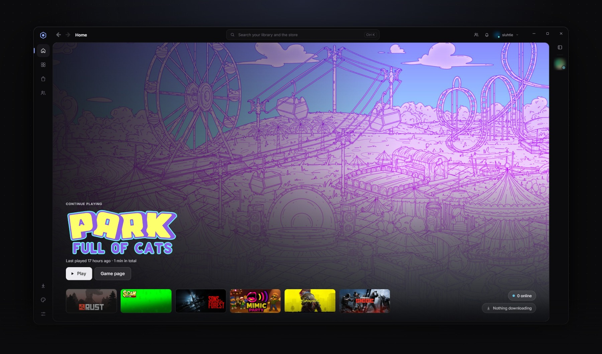 | 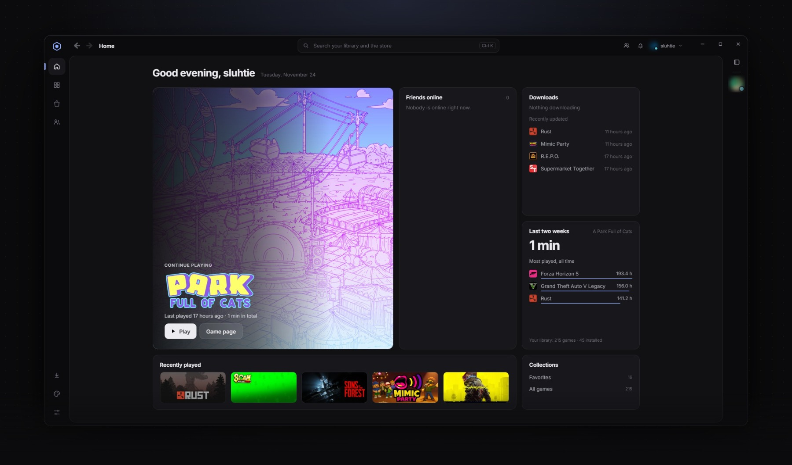 |

## The Graphite 2.0 layout

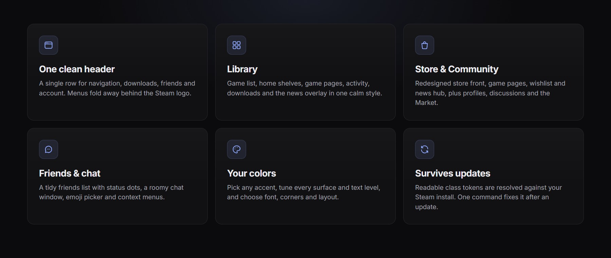

Graphite 2.0 is the default layout for the main window. The earlier layouts stay available under **Navigation** (see [Make it yours](#make-it-yours)): Clean and Classic.

- **Icon rail** on the left: Home, Library, Store, Community, Downloads (with a progress ring), Graphite settings and Steam settings. The Graphite logo replaces the Steam logo and holds View / Friends / Games / Help.
- **Start page** of your own for Home (Cockpit, Spotlight, Bento; see [What's new in 2.1](#whats-new-in-21)), or Steam's library home.
- **One search** in the title bar for your library and the store, with live store suggestions, prices and discounts as you type (`Ctrl K`).
- **Side navigation** for the store (Discover, Wishlist, Points Shop, Cart, browse, categories, news, charts) and the community (activity, profile, friends, groups, discussions, workshop, market, inventory, badges ...). The page sits next to it in a rounded frame with a floating scrollbar and a thin loading bar.
- **Friends dock** on the right: friends by status, a status menu (Online, Away, Invisible, Offline, Do not disturb), unread glow and your chats.
- **Store, redesigned**: hero cards on the store front and on every category page (art, logo, description, price, add to cart, wishlist), a Points Shop with its own banner and category chips, calm capsules, prices and hover cards.
- **Graphite settings page**: accent presets and every color applied live, font, corners and layout options, one click to reload the UI. Since 2.1 also in Clean and Classic.
- **The details**: a startup screen and loading spinners with the Graphite logo, notifications and toasts in the same style.

## Screenshots

**Library**

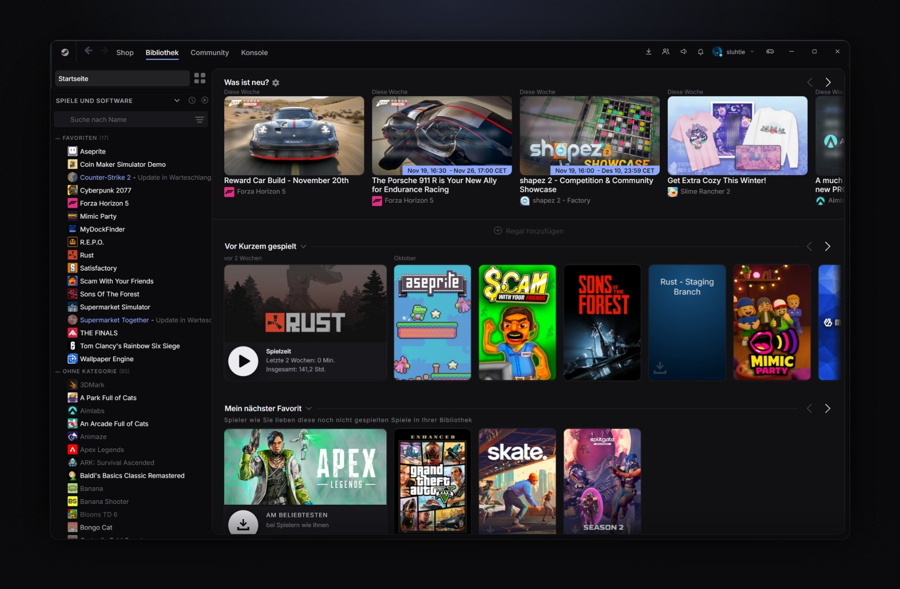

| **Game details** | **Store** |
| --- | --- |
|  |  |
| **Category page** | **Points Shop** |
| 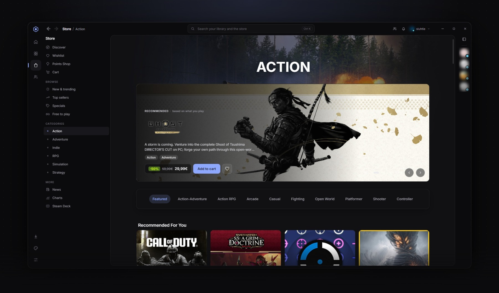 | 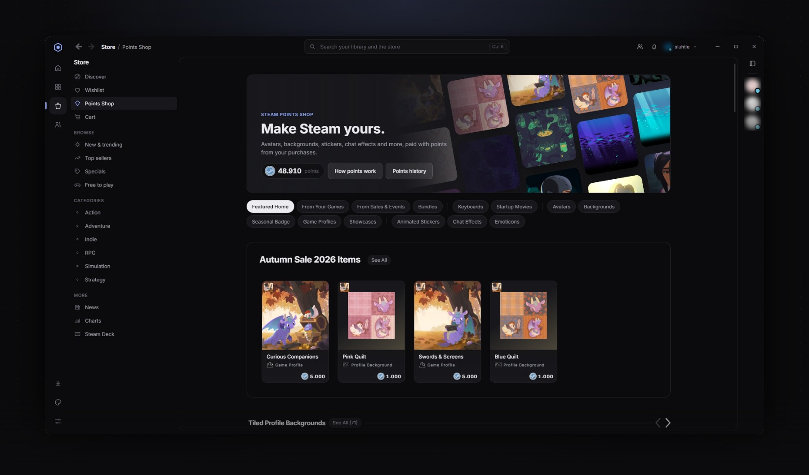 |
| **Store game page** | **Wishlist** |
| 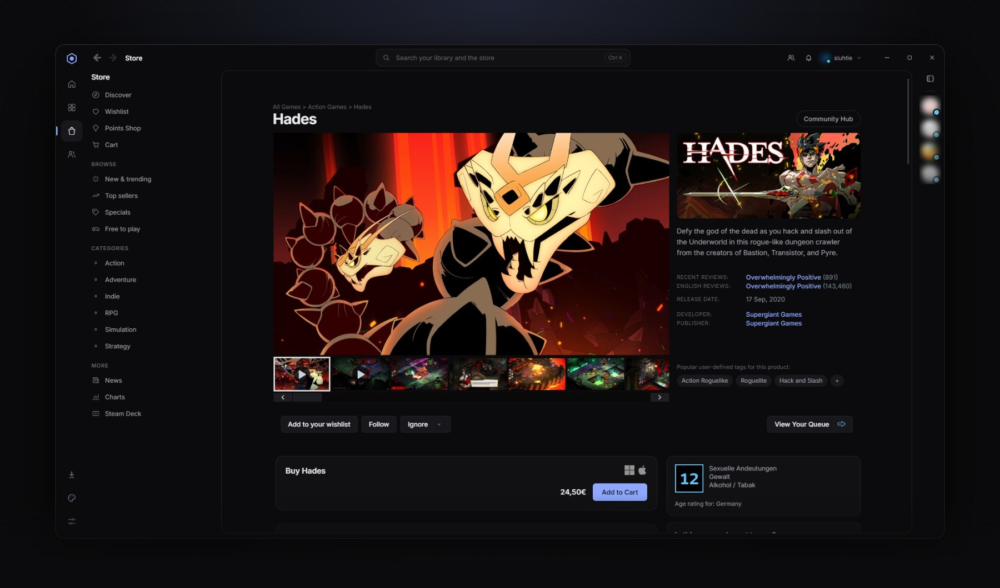 |  |
| **Community Market** | **Graphite settings** |
| 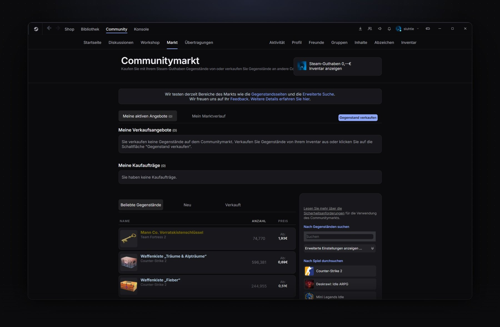 | 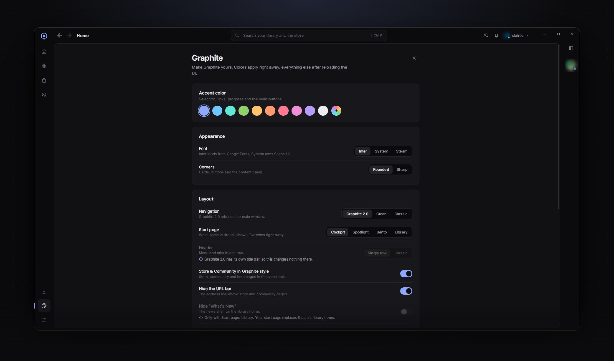 |

## What it themes

| | Area | What changes |
| --- | --- | --- |
| 🧭 | **Navigation** | **Graphite 2.0:** icon rail, title bar search, side navigation for store and community, friends dock. **Clean:** one row with back / forward, Store / Library / Community, downloads, friends, notifications and account; View / Friends / Games / Help fold away behind the logo. **Classic:** Steam's own menus. |
| 🪟 | **Window frame** | Own icon set for the title bar and window controls, round avatar with a status dot, no bottom bar. In 2.0 the store and community sit in a rounded frame with a loading bar. |
| 🎮 | **Library** | Start pages (Cockpit, Spotlight, Bento) in 2.0, game list, home shelves and capsules, hover cards, game details (hero, play bar, sections, activity), news and patch notes overlay, downloads with the bandwidth graph, install / uninstall dialogs, console. |
| 🛒 | **Store** | Store front and category pages with one hero card each, game pages (one card per purchase option), wishlist and its dialogs, search with filters, new & trending, points shop and points history, discovery queue, news hub, calendar and charts. |
| 👥 | **Community** | Home, hubs, discussions, workshop, activity, profiles, friends and groups, screenshots / artwork / guides, badges, inventory and the Community Market incl. the new item pages. |
| 💬 | **Friends & chat** | Friends list with status dots, group chats with channels, a roomy chat window, emoji picker. |
| 🧩 | **Menus & dialogs** | One style for every menu (root menus, dropdowns, context menus), the settings window, toggles, inputs, buttons, modals, notifications and toasts. |
| ⏳ | **Loading** | Steam's spinning logo becomes the Graphite logo everywhere; 2.0 adds a startup screen while the main window loads. |

Custom profile backgrounds stay visible, discount badges keep Steam's green, and item rarity and online / in-game colors are untouched.

## Make it yours


Everything is set in **Millennium → Themes → Graphite**, and also on the **Graphite page** in the client, where colors apply right away. Open it with the palette icon: in the rail with Graphite 2.0, next to the notifications with Clean and Classic.

| Option | Choices |
| --- | --- |
| **Colors** | Accent (with presets), play button, background, surfaces, borders and three text levels, all editable |
| **Font** | Inter (default), System (Segoe UI), Motiva Sans |
| **Corners** | Rounded (default), Sharp |
| **Navigation** | Graphite 2.0 (default), Clean, Classic (Steam's own menus and hover dropdowns) |
| **Header** | Clean and Classic: single row (default) or the classic two-row layout |
| **Store & community pages** | Restyle the in-client web pages (on by default) |
| **Start page** | What Home shows (2.0): Cockpit (default), Spotlight, Bento, Library. Switches right away on the Graphite page |
| **Startup screen** | The Graphite logo while the main window loads (2.0, on by default) |
| **Extras** | Hide URL bar (on by default), Hide What's New, Hide "Add shelf" |

Options other than colors take effect after reloading the UI (the Graphite page offers a button) or restarting Steam. A new **Navigation** layout needs a Steam restart. Options that don't apply with your other choices (for example the header with Graphite 2.0, or Hide What's New with a start page of its own) are greyed out on the Graphite page and say what they need.

## Install

1. Install [Millennium](https://steambrew.app).
2. Get Graphite from its page on [steambrew.app](https://steambrew.app/theme/AhWCRyHBVXoohiaVWWBW), or clone it into Steam's theme folder:

   ```powershell
   cd "C:\Program Files (x86)\Steam\millennium\themes"
   git clone https://github.com/sluhtie/graphite-steam
   ```

   You can also download the ZIP and extract it there.
3. Restart Steam, open **Steam → Millennium → Themes** and select **Graphite**.
4. Graphite 2.0 is the default layout, with the Cockpit start page. Pick another start page under **Start page**. For Clean or Classic, change **Navigation** and restart Steam.

## After a Steam update

Steam's UI uses hashed class names (like `_3pofGqV0buiKAfMPEs3_82`) that can change with client updates. If parts of the theme stop applying, rebuild it against your install (needs [Node.js](https://nodejs.org) 18+):

```powershell
cd "C:\Program Files (x86)\Steam\millennium\themes\graphite-steam"
node tools/build.mjs
```

Then restart Steam. The build lists any class it can no longer find.

## How it works

Graphite's source CSS in `src/` uses readable tokens instead of hashes, and a small build step resolves them against your Steam install:

```css
/* src/partials/frame.css */
.$(SuperNavMenu).$(Selected@SuperNav) .$(MenuButton@SuperNav) { color: var(--gr-text); }
```

- `$(Key)` is the class `Key` from Steam's CSS modules. It must be unique.
- `$(Key@Anchor)` is `Key` from the module that also defines `Anchor`, for common names like `Container`.

`tools/build.mjs` reads Steam's `steamui/*.js` bundles, extracts every module's `name -> hash` map and writes the resolved CSS and scripts to `build/`. That output is committed, so the theme works without a build step.

The store and community are Valve's web pages. Older parts use stable class names; newer React parts use Valve's web design system, whose color scales Graphite remaps on `:root`. Small local scripts handle the rest:

- **`src/scripts/shell.js`** (Navigation: Graphite 2.0): builds the 2.0 layout on top of Steam's own UI. Rail, search and side navigation use Steam's router and `steam://` URLs, so every page is still Steam's real page. The store and community are Steam's native browser view, which follows a placeholder element, so resizing that element moves the page into the frame. Also includes the start pages (`shell-home.js`), the Graphite settings page (`shell-theme.js`), the store hero cards and the Points Shop (`points.js`). On store and community pages it asks Millennium for the layout and steps back if Graphite 2.0 isn't set, so a layout switch without a restart doesn't hide the store's own navigation.
- **`src/scripts/web-recolor.js`** (Store & community option): swaps the hardcoded blue-greys of Valve's newest React pages for Graphite surfaces, and tags the parts of the wishlist, game pages, news hub, category pages and event overlay with stable `gr-*` classes, so the theme can restyle them despite Valve's changing class names.
- **`src/scripts/clean.js`** (Navigation: Clean): `nav.js` stops the tab dropdowns from opening on hover, moves Downloads and Friends & Chat into the title bar and adds the community sub-navigation; `theme-page.js` adds the Graphite page with its title bar button.
- **`src/scripts/theme-page.js`** (Navigation: Classic): the Graphite page and its title bar button.

Graphite has no server of its own and sends no data anywhere. Besides the Inter font from Google Fonts (pick **Font: System** to avoid it), the only requests are Steam's own: the store's `appdetails` API from inside the store page (for the hero cards) and Steam's search suggestions through the client's connection (for the title bar search). Settings are read and written through Millennium.

## Development

| Command | Purpose |
| --- | --- |
| `npm run build` | Resolve tokens and write `build/` |
| `npm run live` | Inject the built theme into a running Steam started with `-dev` (DevTools on port 8080), without restarting Steam. `--set "Option=Value"` previews an option, `--colors` also injects `colors.css` |
| `node tools/lookup.mjs <Key or hash>` | Show which Steam module defines a class, plus unique anchors |
| `node tools/render-docs.mjs ...` | Render the README images from `docs/src` (see [docs/src/README.md](docs/src/README.md)) |

```text
skin.json        Millennium manifest: window patches and options
colors.css       Editable color variables (Millennium RootColors)
src/             Source CSS with $(Token) class references
  main.css       Main window (library, frame)
  menus.css      Popup menus
  dialogs.css    Settings and other dialog windows
  friends.css    Friends list and chat
  toasts.css     Desktop notifications
  partials/      Shared pieces pulled in with @import
  options/       Stylesheets toggled by theme options (shell.css = 2.0 layout, webkit.css = store/community)
  scripts/       shell.js (2.0 layout, incl. shell-home.js, shell-theme.js, points.js, nav.js), clean.js (nav.js + theme-page.js),
                 theme-page.js (Graphite page for Clean / Classic), web-recolor.js (React web pages, incl. marketing.js)
build/           Generated output loaded by Millennium (do not edit)
tools/           Build, live preview, lookup and docs render scripts
docs/            README images; docs/src holds their HTML sources and raw captures
```

## License

[MIT](LICENSE)
